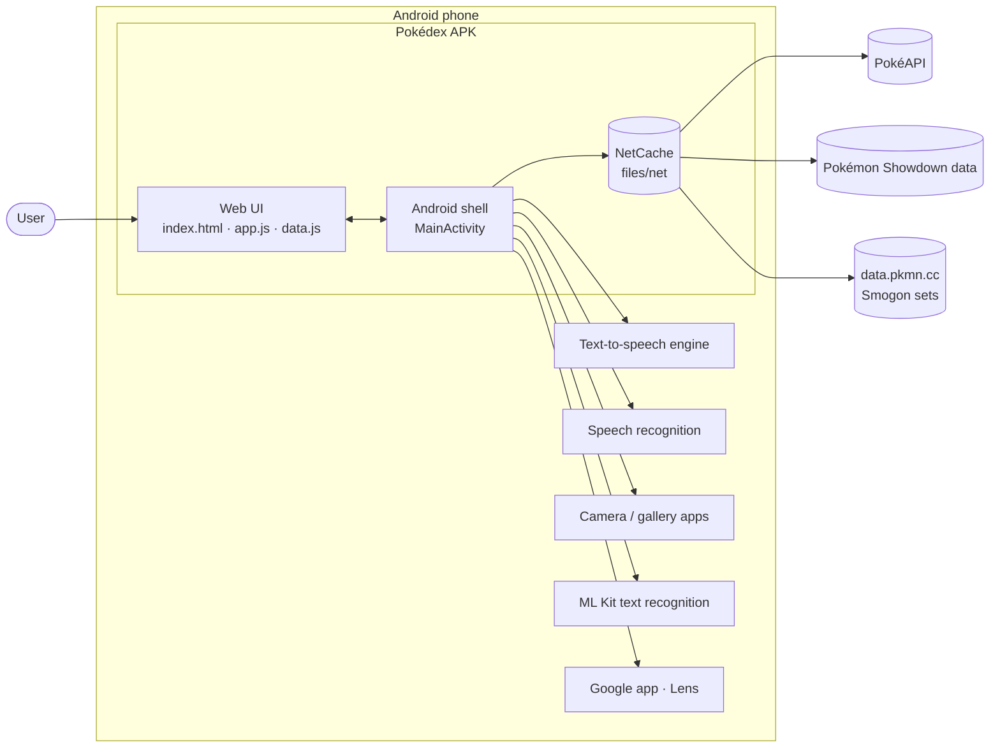

# Software Requirements Specification
## Pokédex for Android

| | |
|---|---|
| Version | 1.3 (matches app build 15) |
| Date | 26 November 2026 |
| Owner | htiekk0k |
| Status | Baseline: describes the implemented system |

---

## Table of contents
1. [Introduction](#1-introduction)
2. [Overall description](#2-overall-description)
3. [External interface requirements](#3-external-interface-requirements)
4. [Functional requirements](#4-functional-requirements)
5. [Non-functional requirements](#5-non-functional-requirements)
6. [Data requirements](#6-data-requirements)
7. [Traceability matrix](#7-traceability-matrix)
8. [Known limitations and future work](#8-known-limitations-and-future-work)
9. [Appendix: diagrams](#9-appendix-diagrams)

---

## 1. Introduction

### 1.1 Purpose
This document specifies the software requirements for **Pokédex**, a personal Android application that works like the Pokédex device from the Pokémon games. It lets the user find a Pokémon by name, number, voice or camera, hear its Pokédex entry read aloud, and look up competitive data (stats, learnsets, Smogon sets) under the rules of a chosen game or format.

It is written for the owner/maintainer and anyone extending the codebase.

### 1.2 Scope
The product is an Android APK made of:
- a native Android shell (Java) that hosts the user interface in a WebView and exposes device features (text-to-speech, speech recognition, camera and gallery, on-device text recognition, share intents, clipboard, file cache), and
- a web user interface (HTML/CSS/JavaScript) bundled inside the APK.

All Pokémon data is read at run time from public sources (PokéAPI, Pokémon Showdown data, Smogon sets via data.pkmn.cc) and cached on the device for offline use. The app uses **no paid or AI services** and needs **no account or API key**.

Out of scope: battle simulation, team building and storage, user accounts, cloud sync, publishing on Google Play.

### 1.3 Definitions, acronyms and abbreviations

| Term | Meaning |
|---|---|
| Species | A Pokémon as a whole, e.g. *Charizard* (National Pokédex number 6). |
| Form | A variant of a species with its own data, e.g. *Mega Charizard X*, *Alolan Ninetales*. |
| Entry | The short description text shown in a game's Pokédex ("flavor text"). |
| Version group (VG) | A set of games sharing a learnset, e.g. *Scarlet / Violet*. |
| Learnset | The moves a Pokémon can learn in a version group, by method (level-up, TM, egg, tutor). |
| Smogon | Smogon University, the community that defines competitive formats and publishes sets. |
| Rules | The game whose mechanics a Smogon format uses: Gen I–IX or Pokémon Champions. |
| Format / tier | A Smogon battle format, e.g. OU, Ubers, Battle Stadium Singles, VGC 2026. |
| Set | A recommended moveset: item, ability, nature, EVs/IVs, Tera type, moves. |
| BST | Base stat total. |
| OCR | Optical character recognition (reading text in images). |
| TTS | Text-to-speech. |
| Lens | Google Lens, Google's visual search, reached through the Google app. |
| Bridge | The JavaScript ↔ Java interface (`window.Native`). |
| NetCache | The app's download-and-store layer for remote data. |

### 1.4 References
- PokéAPI v2: https://pokeapi.co/docs/v2
- Pokémon Showdown client data: https://play.pokemonshowdown.com/data/
- pkmn Smogon data API: https://github.com/pkmn/smogon (data at https://data.pkmn.cc)
- Android developer documentation: WebView, TextToSpeech, RecognizerIntent, FileProvider
- Google ML Kit Text Recognition v2
- IEEE Std 830-1998, *Recommended Practice for Software Requirements Specifications*

### 1.5 Overview
Section 2 describes the product in context. Sections 3–6 state the requirements. Section 7 traces requirements to use cases. Section 8 lists limitations. The UML diagrams live in [`docs/diagrams`](diagrams/).

---

## 2. Overall description

### 2.1 Product perspective
Pokédex is a self-contained mobile application. It depends on three public data sources and on standard Android and Google components installed on the phone.

See also the [component diagram](diagrams/component-diagram.md).

### 2.2 Product functions (summary)
1. Browse every Pokémon and form; search by name or number.
2. Filter (type, generation introduced, category, forms, evolution stage, Smogon tier, ability) and sort (number, name, BST, any stat).
3. Find a Pokémon by voice.
4. Identify a Pokémon from a photo with Google Lens and return to its entry.
5. Look up a Pokémon from text or a screenshot shared or selected in another app.
6. Show a Pokémon page with four tabs: Entry (including base stats), Moves, Smogon, Evolution.
7. Read the Pokédex entry aloud.
8. Show Smogon sets for any rules (Gen I–IX, Champions) and format, and remember a default.
9. Work offline for anything viewed before.
10. Check for, download and install new versions from inside the app.

### 2.3 User classes and characteristics

| User class | Description | Main needs |
|---|---|---|
| Casual fan | Collects cards or toys, watches the anime | Identify a Pokémon quickly; hear its entry |
| Game player | Playing a main-series game | Types, matchups, moves learned in that game, evolutions |
| Competitive player | Plays on Pokémon Showdown or Pokémon Champions | Smogon sets for a chosen format; copy sets to Showdown |

The app has a single local user; there are no roles or permissions.

### 2.4 Operating environment
- Android 8.0 (API 26) or newer; built against API 34.
- Android System WebView (Chromium).
- A text-to-speech engine (e.g. Google Speech Services).
- Optional: a speech-recognition service, a camera app and the Google app (for Lens).
- Internet for first use and for data not yet cached.

### 2.5 Design and implementation constraints
- **C-1** No paid services, AI APIs or API keys.
- **C-2** Data must come from public, freely accessible sources.
- **C-3** Distributed as a sideloaded APK built by GitHub Actions. Every build is signed with the same key so updates install over the previous version.
- **C-4** The UI runs inside a WebView with a local origin (`https://appassets.androidplatform.net`). All remote data is fetched by the Java layer, not by the WebView, which avoids cross-origin restrictions.
- **C-5** Smogon set data is © Smogon and its contributors; the app is for personal use only.
- **C-6** Pokémon names and artwork are trademarks and copyright of Nintendo, Creatures Inc. and GAME FREAK inc.; the app is fan-made and unaffiliated.

### 2.6 Assumptions and dependencies
- **A-1** PokéAPI, the Showdown data files and data.pkmn.cc keep their current URL structures (see §6).
- **A-2** Google Lens cannot return a result to another app, so the return path relies on the clipboard or Android's text-selection menu.
- **A-3** Smogon's set coverage determines which formats show sets; some formats (e.g. CC1v1, Draft, BL tiers) have no set data.

---

## 3. External interface requirements

### 3.1 User interfaces
- **UI-1** Home screen: red Pokédex shell header with lens graphic, title and settings cog; search field; *Say a name* and *Lens* buttons; filter/type chip row; result count; scrollable list (artwork thumbnail, number, name, form label, type badges).
- **UI-2** Pokémon page: back button, title, settings cog; artwork "screen"; name, category, types; *Read entry aloud* button with a blinking light while speaking; form chips; tabs Entry · Moves · Smogon · Evolution.
- **UI-3** Bottom sheets for Settings, Filters, Lens, pickers (game, format) and lookup results.
- **UI-4** Every touch target is at least 44 × 44 dp; text inputs use 16 px or larger; the layout adapts from 360 dp phones to tablets.

### 3.2 Hardware interfaces
- **HW-1** Camera, through the system camera app (`ACTION_IMAGE_CAPTURE`). The app itself declares no camera permission.
- **HW-2** Microphone, through the system speech recogniser (`ACTION_RECOGNIZE_SPEECH`). The app itself declares no audio permission.
- **HW-3** Speaker, through Android `TextToSpeech`.

### 3.3 Software interfaces

| ID | Interface | Used for | Protocol |
|---|---|---|---|
| SI-1 | PokéAPI `/pokemon-species/{n}`, `/pokemon/{id}`, `/evolution-chain/{id}`, `/ability/{name}`, `/move/{name}`, `/pokemon?limit=3000` | Entries, stats, abilities, learnsets, evolutions, form IDs | HTTPS GET, JSON |
| SI-2 | PokéAPI sprites (GitHub raw) `…/other/official-artwork/{id}.png` | Artwork | HTTPS GET, PNG |
| SI-3 | Showdown `data/pokedex.json`, `data/moves.json`, `sprites/gen5/*.png` | Species index, forms, tags, tiers, move data, fallback sprites | HTTPS GET |
| SI-4 | data.pkmn.cc `sets/index.json`, `sets/{rules}.json`, `randbats/{rules}{format}.json` | Smogon sets, format list, Random Battle sets | HTTPS GET (302 → pkmn.github.io) |
| SI-5 | Android TextToSpeech | Read-aloud | Android API |
| SI-6 | RecognizerIntent | Voice search | Activity result |
| SI-7 | ML Kit `text-recognition` 16.0.1 | OCR of shared images | On-device library |
| SI-8 | Google app (`com.google.android.googlequicksearchbox`) or Lens app (`com.google.ar.lens`) | Visual identification | `ACTION_SEND image/jpeg` + FileProvider URI |
| SI-9 | Intents received: `ACTION_SEND` (text/plain, image/*), `ACTION_PROCESS_TEXT` | Look up from other apps | Android intents |
| SI-10 | ClipboardManager | Return path from Lens; copy Showdown sets | Android API |
| SI-11 | GitHub REST API `GET /repos/htiekk0k/Pokedex/releases/latest` and release asset download | In-app updates | HTTPS, JSON + APK |
| SI-12 | Android package installer (`ACTION_VIEW` `application/vnd.android.package-archive`) and *Install unknown apps* settings | Installing updates | Intent + FileProvider URI |

### 3.4 Internal interface: JavaScript bridge
The Java layer exposes `window.Native` to the UI and pushes events back with `window.onNative(event)`.

| Direction | Name | Purpose |
|---|---|---|
| JS → Java | `ready()` | UI loaded; flush queued events |
| JS → Java | `speak(text, rate, pitch)`, `stopSpeaking()` | TTS |
| JS → Java | `listen()` | Start voice input |
| JS → Java | `scan('lens-camera' \| 'lens-gallery' \| 'camera' \| 'gallery')` | Photo → Lens, or photo → OCR |
| JS → Java | `checkClipboard()`, `stopLensWatch()` | Lens return path |
| JS → Java | `copy(text)`, `openUrl(url)`, `toast(msg)` | Utilities |
| JS → Java | `cacheSize()`, `clearCache()`, `version()`, `buildNumber()` | Settings |
| JS → Java | `checkUpdate(quiet)`, `downloadUpdate(url)`, `installUpdate()` | In-app updates |
| Java → JS | `{type:'voice', results[]}` | Recognised phrases |
| Java → JS | `{type:'ocr', lines[{t,h,y}]}` | Recognised text lines with heights |
| Java → JS | `{type:'text', source, text}` | Shared, selected or clipboard text |
| Java → JS | `{type:'lensBack'}` | Returned from Lens with nothing new copied |
| Java → JS | `{type:'tts', state}` | Speaking started / finished |
| Java → JS | `{type:'busy'|'cancel'|'error', …}` | Progress and errors |
| Java → JS | `{type:'update'|'updateProgress'|'updateReady'|'updatePermission'|'updateError', …}` | Update check result, download progress, install state |
| WebView → Java | `GET /net?u={url}&ttl={s}&w={px}` | Cached fetch (NetCache) |

---

## 4. Functional requirements

Priorities: **H** = must have, **M** = should have, **L** = nice to have.

### 4.1 Browse and search (UC-01)
| ID | Requirement | Pri |
|---|---|---|
| FR-1.1 | On first launch the app shall download the species index and show every Pokémon and form (National Dex order, base form before its forms). | H |
| FR-1.2 | The list shall load incrementally while scrolling (60 rows first, then 90 more at a time). | H |
| FR-1.3 | Each row shall show official artwork, the four-digit National Dex number, the display name, the form label (if any) and type badges. | H |
| FR-1.4 | The search box shall filter by name (ignoring case, accents and punctuation) or by number (`25`, `#25`). | H |
| FR-1.5 | Pressing Enter shall open the Pokémon if exactly one result remains or the name matches exactly. | M |
| FR-1.6 | CAP, custom, unreleased, Totem and Let's Go starter forms shall be excluded. | M |

### 4.2 Filter and sort (UC-02)
| ID | Requirement | Pri |
|---|---|---|
| FR-2.1 | The user shall be able to filter by up to two types; a Pokémon must have all selected types. | H |
| FR-2.2 | Filters shall include: generation introduced (I–IX), category (Legendary, Mythical, Ultra Beast, Paradox, Mega & Primal, Regional, Gigantamax), forms (all / base only), evolution (fully evolved, can still evolve, doesn't evolve), Smogon tier (current Gen IX singles) and ability (partial text). | H |
| FR-2.3 | Within one group, options combine with OR; different groups combine with AND. | H |
| FR-2.4 | The user shall be able to sort by number, name, BST, HP, Attack, Defense, Sp. Atk, Sp. Def or Speed. When sorted by a stat, rows shall show that value. | M |
| FR-2.5 | The filter panel shall show a live result count; *Reset* and *Clear* shall restore defaults. | M |

### 4.3 Voice search (UC-03)
| ID | Requirement | Pri |
|---|---|---|
| FR-3.1 | *Say a name* shall open the system speech recogniser (en-US, up to 5 alternatives). | H |
| FR-3.2 | The app shall match names and numbers in the alternatives, giving earlier alternatives more weight. | H |

### 4.4 Identify with Google Lens (UC-04)
| ID | Requirement | Pri |
|---|---|---|
| FR-4.1 | *Lens* shall offer *Take photo → Lens* and *Use a picture → Lens*. | H |
| FR-4.2 | The chosen picture shall be copied into app storage and sent to the Google app (falling back to the Lens app) through a FileProvider URI with read permission. | H |
| FR-4.3 | Before sending, the app shall record the current clipboard. On regaining focus within 15 minutes, it shall read the clipboard; if it changed, it shall look up the copied text. | H |
| FR-4.4 | If nothing new was copied, the app shall show a *Waiting for a name* sheet with *Check again*, *Try another photo* and *Cancel*. | M |
| FR-4.5 | If the copied text contains no Pokémon name, the app shall show what was copied and offer *Check again*. | M |
| FR-4.6 | If neither Google app is installed, the app shall show an error message. | M |

### 4.5 Look up from other apps (UC-05)
| ID | Requirement | Pri |
|---|---|---|
| FR-5.1 | The app shall appear as *Look up in Pokédex* when sharing text or images, and as *Pokédex* in the text-selection menu. | H |
| FR-5.2 | Shared text shall be searched for names, including the `q=` parameter of shared search URLs. | H |
| FR-5.3 | Shared images shall be read with on-device OCR; larger text shall weigh more. | M |

### 4.6 Name matching (shared by UC-03/04/05)
| ID | Requirement | Pri |
|---|---|---|
| FR-6.1 | Matching shall consider word windows of 1–4 words, preferring the longest match, and shall understand regional and Mega prefixes (e.g. "Alolan Ninetales", "Mega Charizard X"). | H |
| FR-6.2 | If no exact match exists, words of 5+ letters shall be fuzzy-matched (edit distance ≤1, or ≤2 for 8+ letters). | M |
| FR-6.3 | With one candidate, or when the top candidate scores ≥1.3× the next, the app shall open it directly; otherwise it shall show a *Which one?* list (up to 8). | H |
| FR-6.4 | With no candidates, the app shall show what was read plus tips. | M |

### 4.7 Pokémon page (UC-06)
| ID | Requirement | Pri |
|---|---|---|
| FR-7.1 | The page shall show official artwork (fitted fully inside the frame), number, name, category, types and form chips. | H |
| FR-7.2 | Forms shall map to their own PokéAPI entry (e.g. `charizard-mega-x`), falling back to the default variety. | H |
| FR-7.3 | The tab bar shall stay visible while scrolling; the chosen tab shall persist when switching between forms of the same species. | M |
| FR-7.4 | If loading fails, the page shall show whether the device is offline, with *Try again*. | H |

### 4.8 Entry tab (UC-06, UC-07)
| ID | Requirement | Pri |
|---|---|---|
| FR-8.1 | A *Game* picker shall list every game with an English entry, grouped by generation, newest first; the default shall be the newest game. | H |
| FR-8.2 | The tab shall show Pokédex data (number, type, category, height in m and ft/in, weight in kg and lbs, abilities with hidden ability marked); tapping an ability shall show its effect. | H |
| FR-8.3 | The tab shall show training data (EV yield, catch rate with full-HP Poké Ball chance, base friendship, base experience, growth rate) and breeding data (egg groups, gender ratio, egg cycles). | H |
| FR-8.4 | The tab shall show base stats (FR-10.1) followed by a type-defence grid (0, ¼, ½, 1, 2, 4). | H |

### 4.9 Read aloud (UC-07)
| ID | Requirement | Pri |
|---|---|---|
| FR-9.1 | *Read entry aloud* shall speak "{Name}. The {category}. {entry for the selected game}." | H |
| FR-9.2 | While speaking, the button shall change to *Stop* and the screen light shall blink; tapping again or leaving the page shall stop speech. | H |
| FR-9.3 | Speed (0.5–1.5×) and pitch (0.5–1.5) shall be adjustable, with *Test voice*. Defaults: 0.95 and 0.85. | M |
| FR-9.4 | When a Pokémon is opened from voice, Lens or a share, the entry shall be read automatically if the setting is on (default on). | M |

### 4.10 Base stats (Entry tab, UC-06)
| ID | Requirement | Pri |
|---|---|---|
| FR-10.1 | The Entry tab shall show the six base stats as coloured bars, the total, and level-100 min–max (hindering nature, 0 EV/IV, to helpful nature, 252 EV, 31 IV). | H |

### 4.11 Moves tab (UC-08)
| ID | Requirement | Pri |
|---|---|---|
| FR-11.1 | A *Game* picker shall list every version group with data for the Pokémon, grouped by generation; the default shall be the main game of the newest generation present. | H |
| FR-11.2 | Moves shall be grouped by Level up, TM/HM/TR, Egg, Tutor and other methods, with level, name, type, category, power and accuracy. | H |
| FR-11.3 | For games before Gen IV, category shall follow the move's type; listed historical type changes shall apply (e.g. Bite = Normal in Gen I). | M |
| FR-11.4 | Tapping a move shall show category, PP, priority and its short effect. | M |
| FR-11.5 | If a form has no separate learnset, the base species' learnset shall be shown with a note. | M |

### 4.12 Smogon tab (UC-09, UC-10)
| ID | Requirement | Pri |
|---|---|---|
| FR-12.1 | A rules picker shall offer Champions and Gen IX–I (only generations where the Pokémon exists). | H |
| FR-12.2 | A *Battle format* picker shall list every format with set data for the chosen rules (from the index), split into "Sets for {Pokémon}" and "Other formats", plus Random Battle (Gen I–IX) and Random Doubles (Gen VIII–IX). | H |
| FR-12.3 | Each set shall show item, ability, nature, Tera type, EVs, IVs, level and moves; slash options shall be kept. | H |
| FR-12.3a | Each move in a set (and in Random Battle move pools) shall show its type, category, power, accuracy, PP and, when non-zero, a priority badge (e.g. *Priority +1*); tapping it shall show the move's effect. Slash options shall appear as separate rows joined by "or". | H |
| FR-12.4 | *Copy for Showdown* shall copy the set in Showdown import format, using the first option of each slash choice. | M |
| FR-12.5 | *Make this my default* shall store the rules and format; Settings shall also allow choosing default rules ("Latest generation (Gen IX)" or a specific one) and a default format. | H |
| FR-12.6 | If the chosen format has no sets for the Pokémon, the tab shall say so and list the formats that do. | M |
| FR-12.7 | *Open on Smogon* shall open the Pokémon's Smogon dex page for the chosen rules. | L |

### 4.13 Evolution tab (UC-06)
| ID | Requirement | Pri |
|---|---|---|
| FR-13.1 | The tab shall show the full evolution chain, including branches, with conditions (level, item, trade, friendship, time of day, location, known move, etc.). | H |
| FR-13.2 | Each stage shall open that Pokémon; the current one shall be highlighted. | M |

### 4.14 Settings and storage (UC-11)
| ID | Requirement | Pri |
|---|---|---|
| FR-14.1 | Settings shall contain: Voice (speed, pitch, test, auto-read), Smogon (default rules, default format), Saved data (size, *Clear saved data*) and About (version, credits). | H |
| FR-14.2 | Settings shall persist across app restarts and updates. | H |

### 4.15 Offline cache (all use cases)
| ID | Requirement | Pri |
|---|---|---|
| FR-15.1 | Every remote resource shall be stored on the device after first download. | H |
| FR-15.2 | Freshness: species index 7 days; PokéAPI and move data 30 days; Smogon sets 3 days; images forever. When stale and online, the app shall refresh; when offline, it shall serve the stored copy. | H |
| FR-15.3 | Thumbnails shall be downscaled before storage (168 px list, 216 px evolution). | M |

### 4.16 In-app updates (UC-12)
| ID | Requirement | Pri |
|---|---|---|
| FR-16.1 | Settings shall show the installed build number and a *Check for updates* button. | H |
| FR-16.2 | Checking shall read the latest GitHub Release, take the build number from its tag (`build-N`) and compare it with the installed version code. | H |
| FR-16.3 | If newer, the app shall show the new build number, download size and the release's change description ("What's new"), with *Download and install* and *Later*. Otherwise it shall say the app is up to date. | H |
| FR-16.4 | The download shall only be accepted from `https://github.com/htiekk0k/Pokedex/…`, show live progress and be stored in the app's private cache. | H |
| FR-16.5 | The app shall hand the APK to Android's package installer. If installing from this app isn't allowed yet, it shall explain the one-time permission, open the *Install unknown apps* screen, and continue automatically on return. | H |
| FR-16.6 | Updates shall install in place (same package name and signing key) so settings and saved data are kept. | H |
| FR-16.7 | When *Check automatically once a day* is on (default), the app shall check at most once per 20 hours on launch and show an *Update available* banner on the home screen instead of interrupting. | M |
| FR-16.8 | Each release shall include the triggering commit message as its description. | M |

---

## 5. Non-functional requirements

| ID | Category | Requirement |
|---|---|---|
| NFR-1 | Performance | After the first run, the home list shall appear within 1 s; a cached Pokémon page within 0.5 s. |
| NFR-2 | Performance | Scrolling the list shall stay smooth (incremental rendering, lazy images, downscaled thumbnails). |
| NFR-3 | Availability | All previously viewed content shall work with no network. |
| NFR-4 | Storage | Cached data shall be clearable by the user; thumbnails shall be under ~40 KB each. |
| NFR-5 | Privacy | The app shall collect no personal data and have no analytics. The clipboard shall be read only during the 15 minutes after a Lens hand-off. Photos stay in the app's private cache. |
| NFR-6 | Security | Only HTTPS shall be used (cleartext disabled). The WebView shall have file and content access disabled. Only the app's own origin is served from assets; other links open in the browser. |
| NFR-7 | Permissions | Declared permissions shall be limited to `INTERNET` and `REQUEST_INSTALL_PACKAGES` (for in-app updates). Camera and microphone are used through other apps. |
| NFR-8 | Usability | Touch targets ≥44 dp; type badges use readable text colours; reduced-motion settings disable animations. |
| NFR-9 | Compatibility | Android 8.0+, phones and tablets, portrait and landscape. |
| NFR-10 | Maintainability | UI logic in plain JavaScript without a framework; static game data isolated in `data.js`; Java limited to platform glue. |
| NFR-11 | Deployability | Every push to `main` shall build a signed APK and publish it as a GitHub Release; version code = build number. |
| NFR-12 | Robustness | Network or parse failures shall never crash the app; each tab shall show its own error with *Try again*. |

---

## 6. Data requirements

### 6.1 In-memory index entry (from Showdown `pokedex.json`)
`id, name, num, base, forme, types[], gen, bs{hp,atk,def,spa,spd,spe}, bst, abilities[], tags[], tier, evos(bool), prevo(bool), pid (PokéAPI id for forms)`

### 6.2 Derived values
- **Generation introduced**: from National Dex ranges; Mega/Primal ≥ VI, Alola VII, Galar/Gmax/Hisui VIII, Paldea IX.
- **Catch chance at full HP with a Poké Ball** ≈ `rate / 3 / 255`.
- **Level-100 stats**: HP `2B+110 … 2B+204`; others `⌊(2B+5)·0.9⌋ … ⌊(2B+99)·1.1⌋`.

### 6.3 Persistent data
| Store | Contents |
|---|---|
| `localStorage['dex.settings']` | `rate, pitch, autoRead, format, smogonRules, autoUpdate` |
| `localStorage['dex.lastUpdateCheck']` | Time of the last update check |
| `cache/updates/Pokedex.apk` | Downloaded update |
| `files/net/{sha1(url[#wN])}` + `.type` | Cached response body and content type |
| `cache/photos/scan.jpg`, `lens.jpg` | Last captured / forwarded photo |

### 6.4 External data shapes relied on
- `sets/{rules}.json`: species → format → set name → set.
- Set fields may be a single value or a list of alternatives (slash options); EVs may be an object or a list of objects.
- `randbats/*.json`: species → `{level, abilities, items, moves, teraTypes}` or `{level, roles{name → …}}`.

---

## 7. Traceability matrix

| Use case | Functional requirements |
|---|---|
| UC-01 Browse & search | FR-1.1–1.6, FR-15 |
| UC-02 Filter & sort | FR-2.1–2.5 |
| UC-03 Voice search | FR-3.1–3.2, FR-6, FR-9.4 |
| UC-04 Identify with Lens | FR-4.1–4.6, FR-6, FR-9.4 |
| UC-05 Look up from another app | FR-5.1–5.3, FR-6, FR-9.4 |
| UC-06 View Pokémon page | FR-7, FR-8, FR-10, FR-13 |
| UC-07 Read entry aloud | FR-9.1–9.3 |
| UC-08 View moves for a game | FR-11.1–11.5 |
| UC-09 View Smogon sets | FR-12.1–12.4 (incl. 12.3a), 12.6–12.7 |
| UC-10 Set default rules & format | FR-12.5, FR-14 |
| UC-11 Manage settings & saved data | FR-9.3, FR-14, FR-15 |
| UC-12 Update the app | FR-16.1–16.8 |

Detailed use-case descriptions are in [diagrams/use-case-diagram.md](diagrams/use-case-diagram.md).

---

## 8. Known limitations and future work
- **Lens return** needs the user to copy or select the name; Google offers no API that returns a Lens result to another app.
- **Smogon coverage**: Champions data currently has OU, Battle Stadium Singles and VGC 2026 (not split by regulation). CC1v1, Draft and BL tiers have no sets.
- **Move power and accuracy** use the latest games' values for every game.
- **Gen I Special**: Sp. Atk and Sp. Def are shown separately.
- **List tier filter** uses current Gen IX singles tiers.
- Possible future work: Champions roster filter, team builder, damage calculator, dark theme, home-screen widget.

---

## 9. Appendix: diagrams
| Diagram | File |
|---|---|
| Use case diagram + use-case descriptions | [diagrams/use-case-diagram.md](diagrams/use-case-diagram.md) |
| Activity diagrams | [diagrams/activity-diagrams.md](diagrams/activity-diagrams.md) |
| Sequence diagrams | [diagrams/sequence-diagrams.md](diagrams/sequence-diagrams.md) |
| State diagrams | [diagrams/state-diagrams.md](diagrams/state-diagrams.md) |
| Component diagram | [diagrams/component-diagram.md](diagrams/component-diagram.md) |
