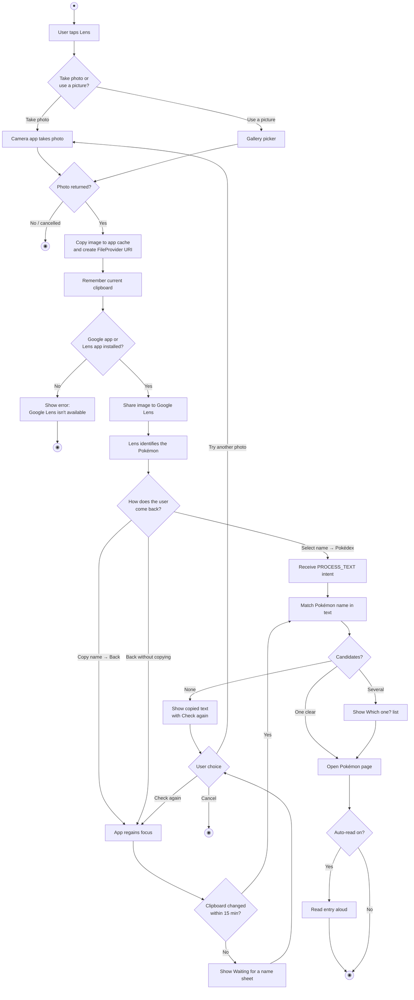
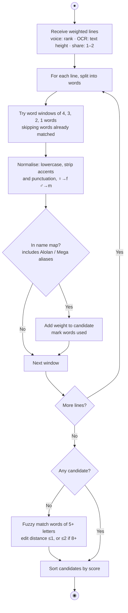
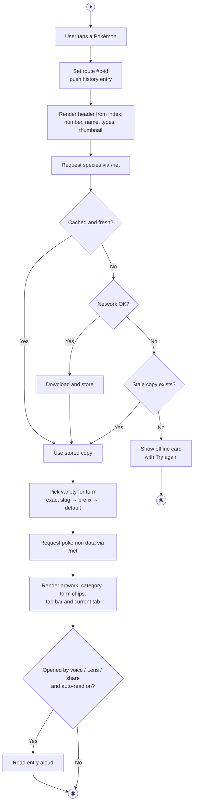
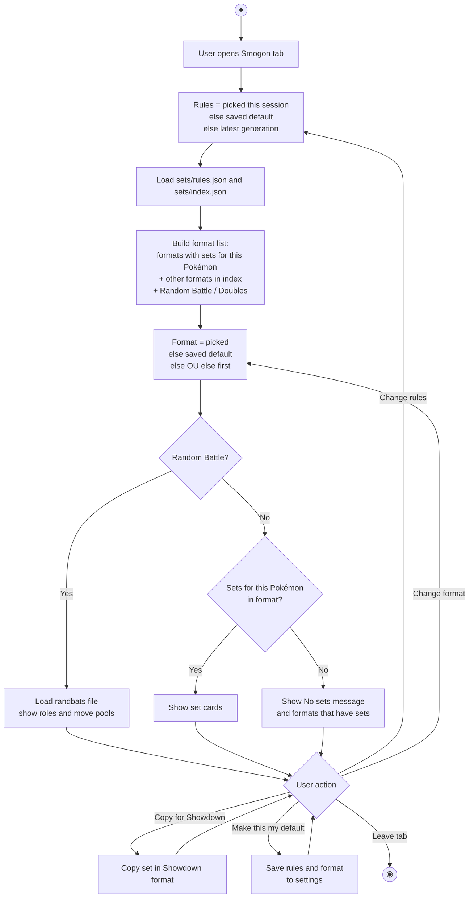

# Activity diagrams

## A-1 Identify a Pokémon with Google Lens (UC-04)

## A-2 Match a Pokémon name in text (shared by voice, Lens, share, OCR)

## A-3 Open a Pokémon page (UC-06)

## A-4 Choose Smogon rules and format (UC-09, UC-10)

