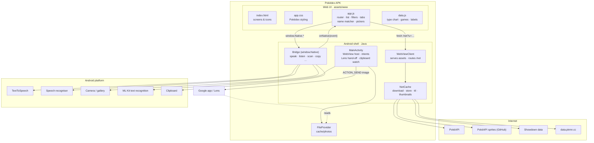

# Component diagram

| Component | Responsibility | Source |
|---|---|---|
| `index.html` | Screen skeleton, icon set | `app/src/main/assets/www/index.html` |
| `app.css` | Visual design, responsive layout | `…/www/app.css` |
| `app.js` | All UI logic: index, search, filters, routing, tabs, pickers, name matching, speech UI | `…/www/app.js` |
| `data.js` | Static reference data: type chart per generation, games ↔ generations, labels | `…/www/data.js` |
| `MainActivity` | Hosts WebView, JavaScript bridge, intents (share, process-text), camera/gallery, OCR, Lens hand-off, clipboard return | `app/src/main/java/dev/personal/pokedex/MainActivity.java` |
| `NetCache` | HTTPS download, on-disk store with time-to-live, offline fallback, thumbnail downscaling | `…/NetCache.java` |
| GitHub Actions | Builds the signed APK and publishes a Release on each push | `.github/workflows/build.yml` |
