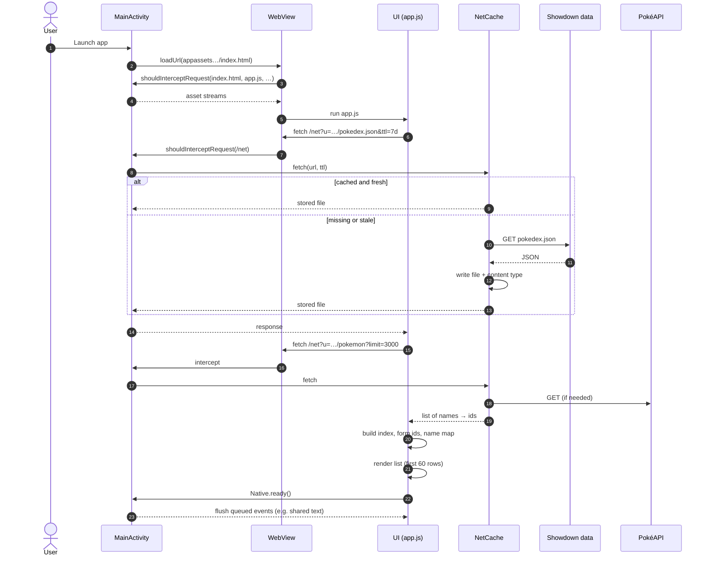
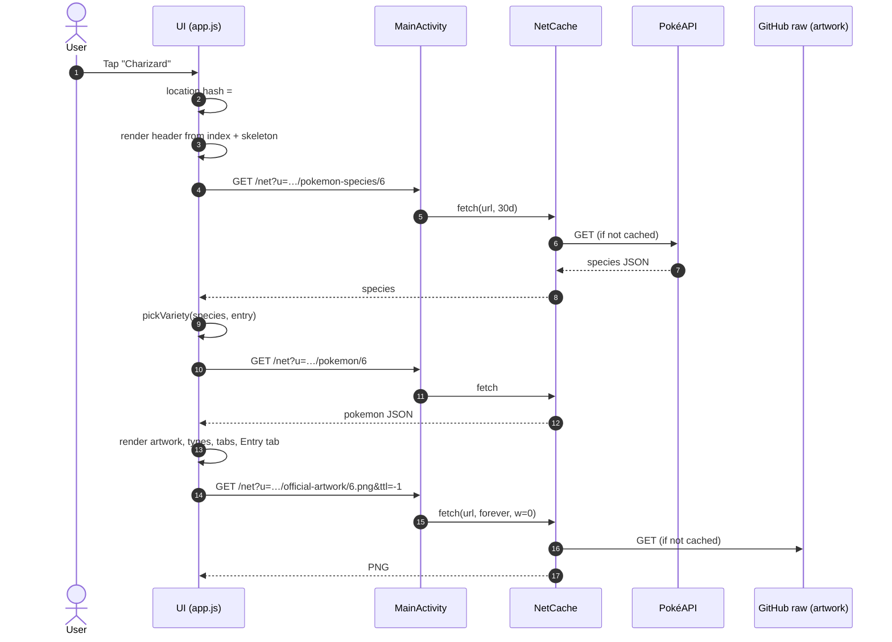
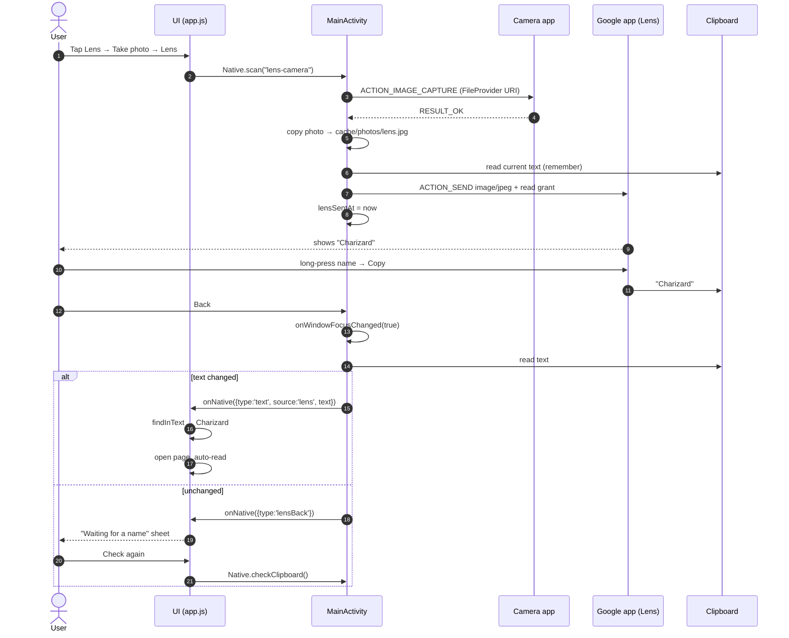
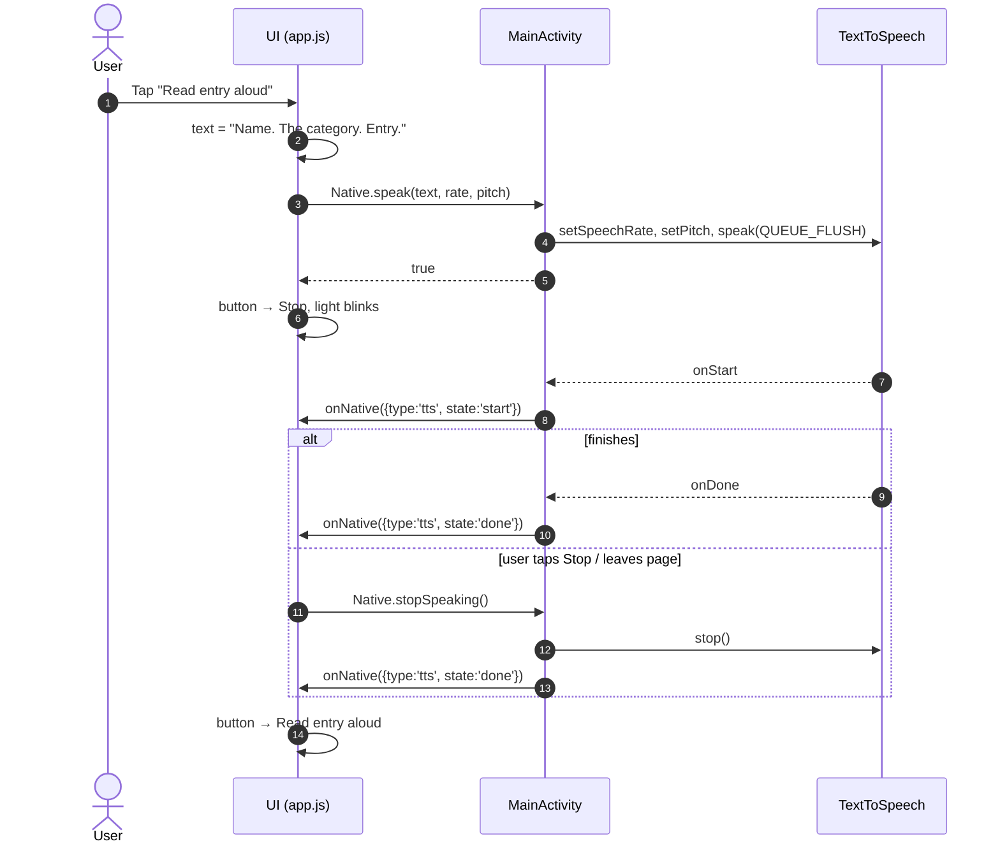
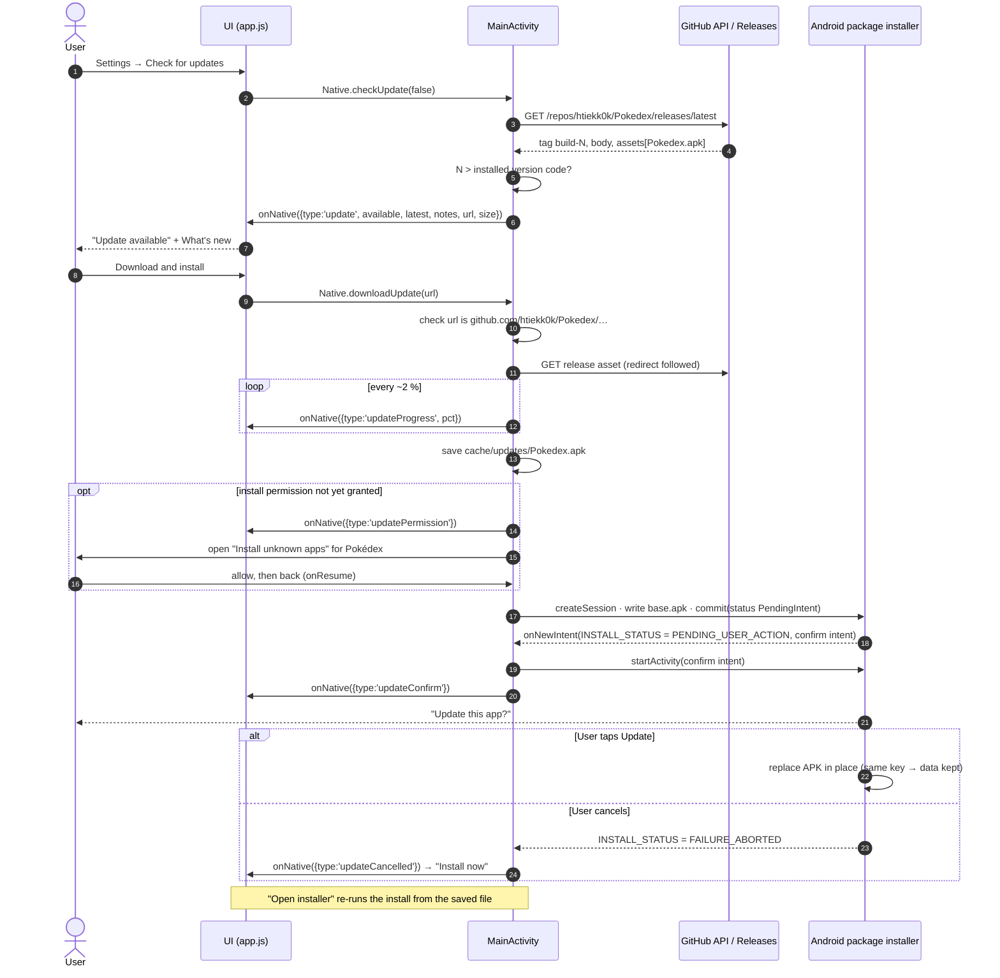
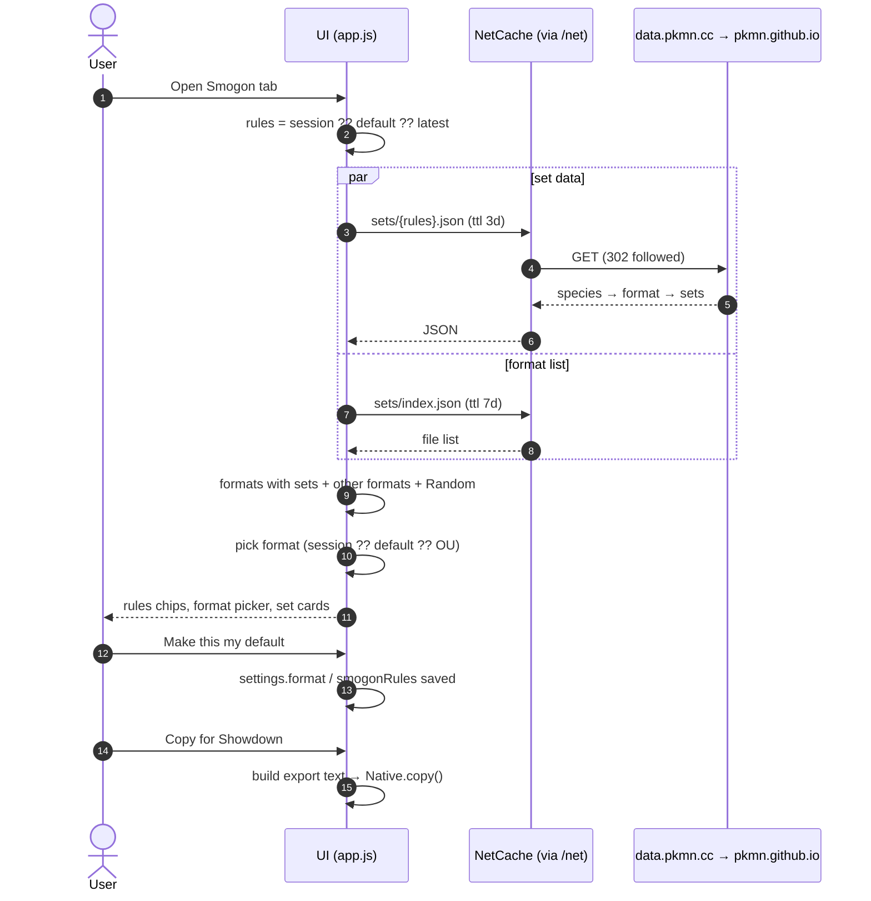

# Sequence diagrams

Participants
- **UI**: the web interface (`app.js`) running in the WebView.
- **WebView**: Android WebView; routes `/net` requests to the Java layer.
- **Activity**: `MainActivity` (Java), including the `Native` bridge and WebView client.
- **NetCache**: download-and-store layer (`NetCache.java`).

## S-1 App start and species index

## S-2 Open a Pokémon page

## S-3 Identify with Google Lens and return

## S-4 Read entry aloud

## S-6 In-app update

## S-5 Smogon tab

