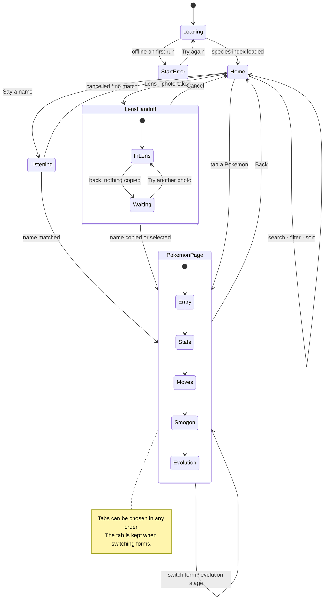
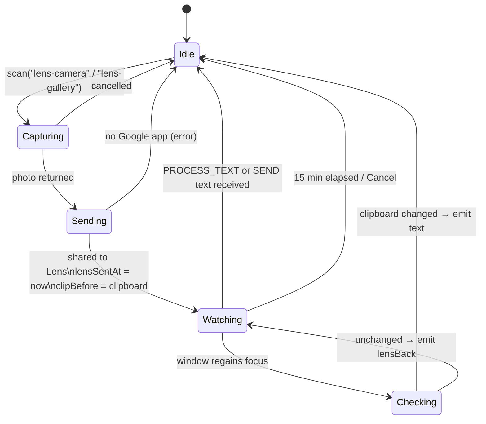
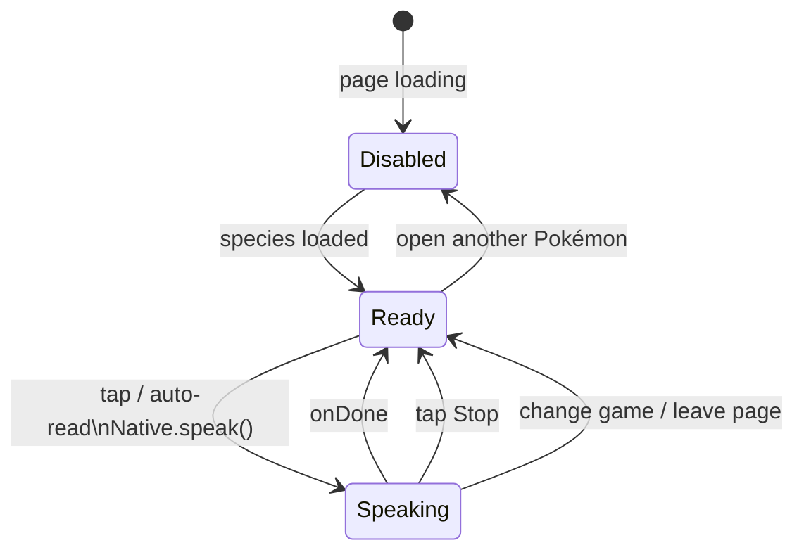
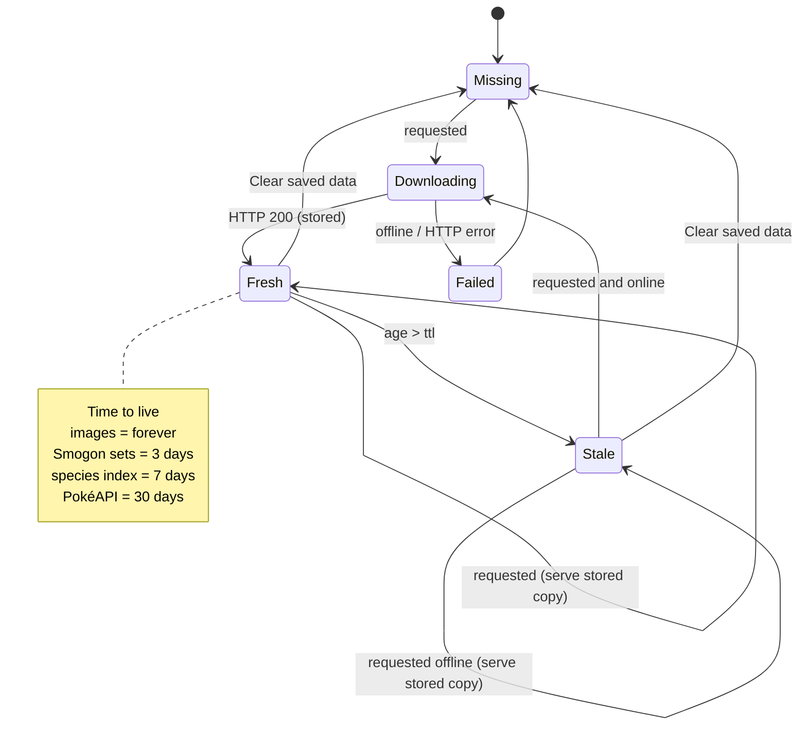
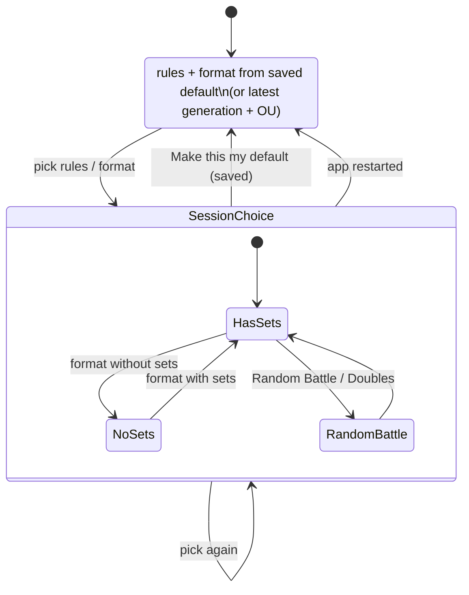

# State diagrams

## ST-1 App screens

Settings, Filters and pickers open as sheets over the current screen and return to it when closed, so they are not drawn as separate states.

## ST-2 Lens return watcher (MainActivity)

## ST-3 Read-aloud button

## ST-4 Cached resource (NetCache)

## ST-5 Smogon tab selection

