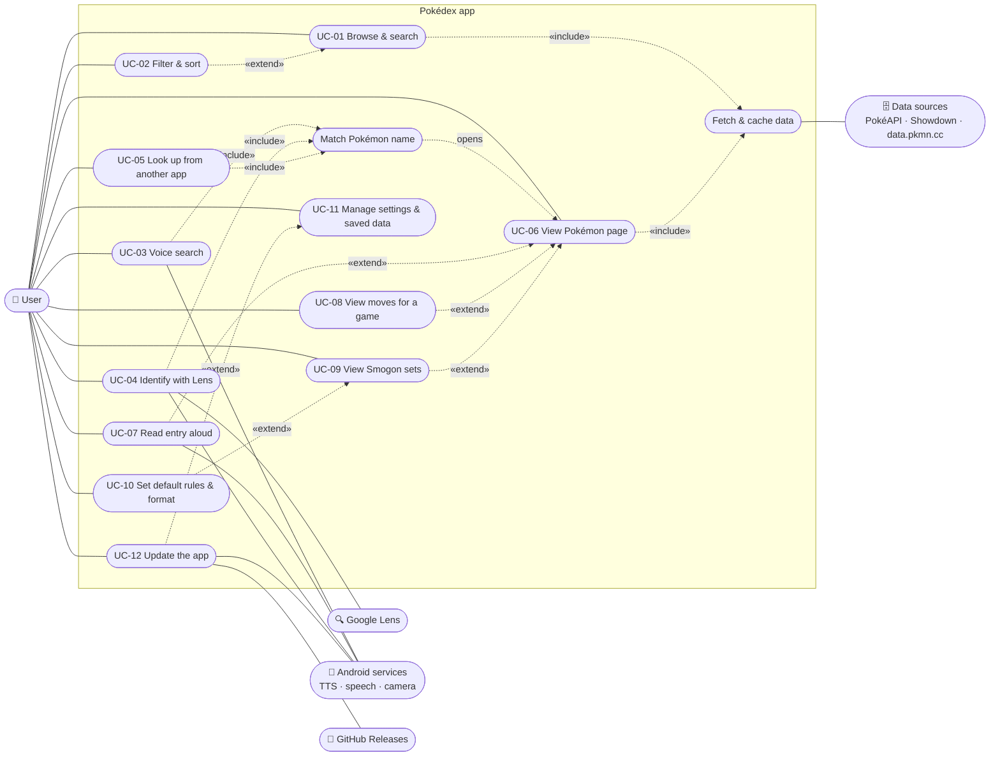

# Use case diagram

Actors
- **User**: the person using the app (primary).
- **Google Lens**: identifies a Pokémon from a photo (secondary, external app).
- **Data sources**: PokéAPI, Pokémon Showdown data and data.pkmn.cc (secondary, external services).
- **Android services**: text-to-speech, speech recognition, camera and gallery, package installer (secondary).
- **GitHub Releases**: hosts each new APK build (secondary).

Mermaid has no native UML use-case notation, so use cases are drawn as rounded nodes inside the system boundary; dashed arrows are «include» / «extend» relationships.

---

## Use-case descriptions

### UC-01 Browse & search
| | |
|---|---|
| Actor | User |
| Precondition | App installed; internet for the first launch |
| Main flow | 1. User opens the app. 2. App loads the species index (from cache or network). 3. App lists all Pokémon. 4. User types a name or number. 5. List narrows as they type. 6. User taps a row → UC-06. |
| Alternatives | 2a. Offline on first launch → "You're offline" with *Try again*. 4a. No match → "No match" message. 4b. User presses Enter with one result → UC-06 opens directly. |
| Postcondition | Pokémon page shown |
| Requirements | FR-1.x, FR-15 |

### UC-02 Filter & sort
| | |
|---|---|
| Actor | User |
| Main flow | 1. User taps *Filters* (or a type chip). 2. User toggles type / generation / category / forms / evolution / tier / ability and sort. 3. Count on *Show N Pokémon* updates live. 4. User taps *Show*. 5. List shows matching Pokémon. |
| Alternatives | 2a. Third type chosen → the oldest type choice is dropped. 4a. User taps *Reset* or *Clear* → all filters removed. |
| Requirements | FR-2.x |

### UC-03 Voice search
| | |
|---|---|
| Actor | User; Android speech recognition |
| Main flow | 1. User taps *Say a name*. 2. System recogniser listens and returns up to 5 phrases. 3. App matches names/numbers (Match Pokémon name). 4. App opens the best match and reads the entry aloud (if auto-read is on). |
| Alternatives | 2a. No recogniser installed → toast. 2b. User cancels → nothing happens. 3a. Several close matches → *Which one?* list. 3b. No match → "No Pokémon found". |
| Requirements | FR-3.x, FR-6.x, FR-9.4 |

### UC-04 Identify with Lens
| | |
|---|---|
| Actors | User; Google Lens; camera/gallery |
| Precondition | Google app (or Lens app) installed |
| Main flow | 1. User taps *Lens* → *Take photo → Lens*. 2. Camera app takes a photo. 3. App copies it and shares it to Google Lens; remembers the clipboard. 4. Lens identifies the Pokémon. 5. User long-presses the name → *Copy* → back. 6. App regains focus, reads the new clipboard text, matches the name and opens the Pokémon. |
| Alternatives | 1a. *Use a picture → Lens* picks from the gallery. 5a. User selects the name → *Pokédex* in the text menu → handled as UC-05. 6a. Clipboard unchanged → *Waiting for a name* sheet (*Check again* / *Try another photo* / *Cancel*). 6b. Copied text isn't a Pokémon → shows it with *Check again*. 3a. No Google app → error message. |
| Requirements | FR-4.x, FR-6.x |

### UC-05 Look up from another app
| | |
|---|---|
| Actor | User |
| Main flow | 1. In another app the user shares text or a screenshot to *Look up in Pokédex*, or selects text → *Pokédex*. 2. App receives the intent. 3. For text: extracts names (including the `q=` of search links). For images: reads text on-device (OCR). 4. Match Pokémon name → UC-06. |
| Requirements | FR-5.x, FR-6.x |

### UC-06 View Pokémon page
| | |
|---|---|
| Actor | User; data sources |
| Main flow | 1. App shows the header immediately from the index. 2. App fetches species + variety data (cache first). 3. App renders artwork, types, category, forms and the Entry tab. 4. User switches tabs (Stats, Moves, Smogon, Evolution) or forms. |
| Alternatives | 2a. Offline and not cached → error card with *Try again*. |
| Requirements | FR-7, FR-8, FR-10, FR-13 |

### UC-07 Read entry aloud
| | |
|---|---|
| Actor | User; text-to-speech |
| Main flow | 1. User picks a game in the Entry tab (optional). 2. User taps *Read entry aloud*. 3. App speaks "Name. The category. Entry." 4. Button shows *Stop*, light blinks. 5. Speech ends → button resets. |
| Alternatives | 2a. TTS not ready → toast. 3a. User taps *Stop* or leaves the page → speech stops. |
| Requirements | FR-9.x |

### UC-08 View moves for a game
| | |
|---|---|
| Main flow | 1. User opens Moves. 2. App picks the newest main game. 3. User taps *Game* and picks any game. 4. App lists moves by method; tapping a move shows its effect. |
| Requirements | FR-11.x |

### UC-09 View Smogon sets
| | |
|---|---|
| Main flow | 1. User opens Smogon. 2. App applies the default rules and format. 3. User picks rules (Champions, Gen IX–I) and a format. 4. App shows sets; user may *Copy for Showdown* or *Open on Smogon*. |
| Alternatives | 3a. No sets in that format → message listing formats that have sets. 3b. Random Battle → shows roles and move pools. |
| Requirements | FR-12.1–12.4, 12.6, 12.7 |

### UC-10 Set default rules & format
| | |
|---|---|
| Main flow | 1. On the Smogon tab the user picks rules and a format. 2. User taps *Make this my default*. 3. App saves both; every Pokémon now opens on them. |
| Alternatives | 1a. User sets *Default rules* and *Default battle format* in Settings. |
| Requirements | FR-12.5, FR-14 |

### UC-11 Manage settings & saved data
| | |
|---|---|
| Main flow | 1. User taps the cog. 2. Adjusts voice speed/pitch, auto-read, Smogon defaults. 3. Optionally clears saved data. |
| Requirements | FR-9.3, FR-14, FR-15 |

### UC-12 Update the app
| | |
|---|---|
| Actors | User; GitHub Releases; Android package installer |
| Main flow | 1. User taps the cog → *Check for updates* (or the *Update available* banner). 2. App reads the latest release and compares build numbers. 3. App shows the new build, size and "What's new". 4. User taps *Download and install*. 5. App downloads with a progress bar. 6. Android's installer asks to confirm; user taps *Update*. 7. The new version opens with settings and data kept. |
| Alternatives | 2a. Offline / GitHub error → "Couldn't check" with *Try again*. 3a. Already latest → "You're up to date". 5a. Download fails → "Update failed" with *Try again*. 6a. Installing from Pokédex not yet allowed → one-time permission screen; on return the install continues. |
| Requirements | FR-16.1–16.8 |
